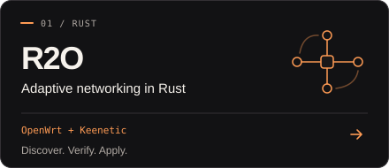
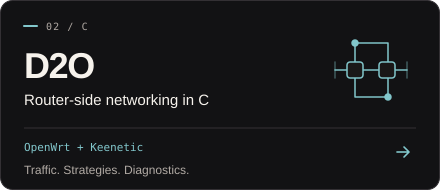

<picture>
  <source media="(prefers-color-scheme: dark)" srcset="assets/hero-dark.svg">
  <source media="(prefers-color-scheme: light)" srcset="assets/hero-light.svg">
  
</picture>

  <a href="https://github.com/t0fox/r2o"><b>R2O</b></a> &nbsp; / &nbsp;
  <a href="https://github.com/t0fox/d2o"><b>D2O</b></a> &nbsp; / &nbsp;
  <a href="https://github.com/t0fox/z2kOW"><b>z2kOW</b></a> &nbsp; / &nbsp;
  <a href="https://github.com/t0fox?tab=repositories">All repositories ↗</a>

I build open-source tools for **Linux, OpenWrt and Keenetic** — from packet processing and local proxies to diagnostics, web panels and signed updates.

**Current focus:** adaptive networking in **Rust and C**. Discover the problem, verify the strategy, make it work on the router.

## Network projects

<table>
  <tr>
    <td width="50%" valign="top">
      <a href="https://github.com/t0fox/r2o">
        <picture>
          <source media="(prefers-color-scheme: dark)" srcset="assets/r2o-card-dark.svg">
          <source media="(prefers-color-scheme: light)" srcset="assets/r2o-card-light.svg">
          
        </picture>
      </a>
      
Rust packet engine, automatic strategy discovery, local Telegram proxy and a web panel.

      
<a href="https://github.com/t0fox/r2o">Explore R2O ↗</a> · <a href="https://github.com/t0fox/r2o/releases">Releases</a>

    </td>
    <td width="50%" valign="top">
      <a href="https://github.com/t0fox/d2o">
        <picture>
          <source media="(prefers-color-scheme: dark)" srcset="assets/d2o-card-dark.svg">
          <source media="(prefers-color-scheme: light)" srcset="assets/d2o-card-light.svg">
          
        </picture>
      </a>
      
Adaptive traffic handling in C, connection diagnostics and a local Telegram proxy.

      
<a href="https://github.com/t0fox/d2o">Explore D2O ↗</a> · <a href="https://github.com/t0fox/d2o/releases">Releases</a>

    </td>
  </tr>
</table>

**[z2kOW ↗](https://github.com/t0fox/z2kOW)** — independent OpenWrt port and extension of z2k. System integration, router services, a local web panel and signed releases.

## Under the hood

| Systems & networking | Build & delivery |
| :--- | :--- |
| Rust · C · Linux · OpenWrt · Keenetic | QEMU · cross-compilation · GitHub Actions |
| TCP/IP · TLS · QUIC · NFQUEUE · nftables | Regression tests · Ed25519 · SHA-256 · rollback |
| Docker · Nginx · PostgreSQL · REST APIs | Service management · automation · diagnostics |

<b>More things I've built</b>

 

| Project | What it does |
| :--- | :--- |
| [Subscription Aggregator API](https://github.com/t0fox/subscription-aggregator-api) | REST API with PostgreSQL, migrations, pagination and health checks. |
| [dev-ops-backend](https://github.com/t0fox/dev-ops-backend) | Containerized backend, Nginx reverse proxy and automated smoke tests. |
| [VelvLens](https://github.com/t0fox/VelvLens) | Portable desktop packaging, local backend and build verification. |

## Contribution trail

<picture>
  <source media="(prefers-color-scheme: dark)" srcset="https://raw.githubusercontent.com/t0fox/t0fox/output/github-contribution-grid-snake-dark.svg">
  <source media="(prefers-color-scheme: light)" srcset="https://raw.githubusercontent.com/t0fox/t0fox/output/github-contribution-grid-snake.svg">
  
</picture>

Generated from my GitHub contributions with <a href="https://github.com/Platane/snk">Platane/snk</a>.

---

  <b>Support my open-source work</b> 
  <a href="https://pay.cloudtips.ru/p/5e6571c5">CloudTips</a> &nbsp; · &nbsp;
  <a href="https://donation.streamiverse.io/t0fox">Streamiverse</a>

